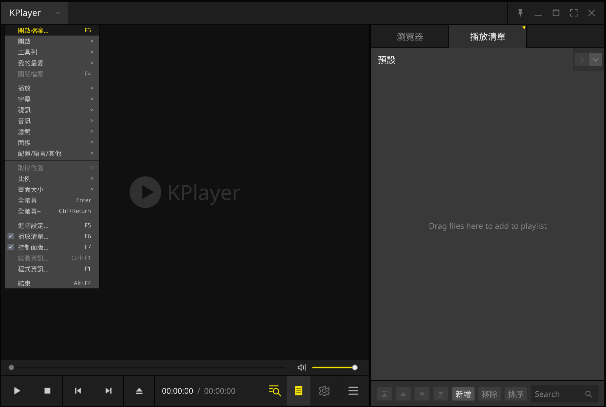

# KPlayer

**A personal desktop media player for watching anime, built with C++20, Qt Quick, and libmpv.**

I used PotPlayer on Windows, mainly for watching anime. After switching to Linux,
I couldn't find a player that matched my preferences and the experience I was
used to. Instead of continuing to search for alternatives, I started building
KPlayer with the controls, playlists, and subtitle workflow I use most.

This is an app I build primarily for myself, around my own preferences and
viewing workflow, and share publicly in case others find it useful. I know other
projects with similar goals exist; KPlayer isn't intended to replace or compete
with them. PotPlayer is an inspiration, but I am not trying to recreate all of
its features or achieve feature parity.

Linux is the main motivation behind the project. The repository also includes a
native Windows build, runtime deployment, and Windows file associations.



## Features

- **Series playback:** discover videos in the opened file's folder, sort episode
  names naturally, and play the next item automatically.
- **Subtitles:** select embedded tracks, load external files, set preferred
  languages, and adjust subtitle appearance and timing.
- **Playback controls:** familiar keyboard shortcuts, frame stepping, adjustable
  speed, repeat modes, and A–B looping.
- **Keep awake:** inhibit automatic sleep and display idle behavior while playing
  on Linux and Windows; release the request when paused, stopped, or closed.
- **Timeline previews:** hover or drag to preview a frame without interrupting
  the current playback.
- **Playlists and favorites:** drag and drop files or folders, search and reorder
  the queue, sort the full queue or only selected tracks, save the current queue
  as a named playlist, and save favorite files or URLs.
- **Audio and video adjustments:** equalizer presets, picture controls, aspect
  ratios, and PNG frame capture.
- **Desktop interface:** fullscreen, always on top, a resizable playlist, and
  English and Traditional Chinese interface languages.

All playlists, their track order, the last active playlist, favorites, interface language,
subtitle language preferences, and playlist width are saved across launches.

## Getting started

Build the player using the instructions below, then launch it with or without
media arguments:

```sh
./build/KPlayer
./build/KPlayer "/path/to/episode.mkv"
./build/KPlayer "https://example.com/video.mp4"
```

Launching without arguments restores the last active playlist, including the
default queue, with playback stopped. Launching by opening a video file replaces
the default queue with that file and its sibling videos and starts playback;
saved named playlists remain available. Use **Open Media** (`Ctrl+O`)
to select files, or drop files onto the playlist to queue them. Opening a local
video also adds other videos from its immediate folder in natural filename
order; subfolders are not scanned. Adding or dropping files into the playlist
preserves their explicit order and does not interrupt playback.

Drop a folder onto the playlist, or choose **Add folder…** from the playlist's
dropdown menu, to create a playlist named after that folder. Only supported
videos directly inside the folder are included, in natural filename order.
Choose **Save current playlist as…** in the same menu to copy the full queue
into a new named playlist. Both folder playlists and saved queues remain
available after restarting KPlayer.

The default interface language is Traditional Chinese. To switch to English,
press `F5`, choose **General > Interface language**, and save. The change applies
immediately and is remembered for the next launch.

Open **Advanced Settings > Shortcuts** (`F5` by default) to view, search, and edit
application, playback, playlist, and subtitle rule shortcuts. Type key names or
use **Record**; separate alternative bindings with semicolons. Conflicting
assignments must be corrected before saving. **Clear** disables a command's
shortcut, and **Reset** restores its defaults. Changes apply on **Save** and
remain available after restarting.

To sort part of a playlist, select tracks with Ctrl-click or Shift-click, open
the playlist's **Sort** menu, and choose **Selected titles: A–Z** or
**Selected titles: Z–A**. Unselected tracks keep their positions.

## Build and run

### Requirements

- A C++20 compiler
- CMake 3.24 or newer and Ninja
- Qt 6.11.2 or newer, including Qt Quick, OpenGL, SVG, and Linguist tools
- libmpv development headers and library
- pkg-config on Linux and macOS
- Qt Test when building the optional tests
- An OpenGL-capable display; on Linux, installed system fonts are also needed

### Linux

From the repository root:

```sh
cmake -S . -B build -G Ninja -DCMAKE_BUILD_TYPE=Release
cmake --build build --parallel
./build/KPlayer
```

If Qt is installed outside the system search paths, add
`-DCMAKE_PREFIX_PATH=/path/to/your/Qt/installation` to the configure command.
You can also open `CMakeLists.txt` in Qt Creator and select a Qt 6.11.2+ kit.

### Arch Linux package

Install the dependencies, including the tools used to compile translations:

```sh
sudo pacman -S --needed base-devel cmake ninja pkgconf qt6-base qt6-declarative qt6-svg qt6-tools qt6-translations mpv
```

The installed Qt packages must satisfy the version requirement above. Build as
your regular user, then install the generated package:

```sh
bash scripts/build-arch.sh
sudo pacman -U build/arch/kplayer-0.1.0-1-$(uname -m).pkg.tar.zst --noconfirm
```

The script packages the current working source, including local edits, into
`build/arch/`. It excludes the optional sample video. The package installs
`/usr/bin/KPlayer`, a desktop launcher, and media file associations.

Additional script arguments are passed to `makepkg`, such as `--syncdeps` to
install missing dependencies. Set `CMAKE_BUILD_PARALLEL_LEVEL` to override the
default of four build jobs.

### Windows (MSYS2 UCRT64)

Install [MSYS2](https://www.msys2.org/). In its **UCRT64** shell, update with
`pacman -Syu`. If the update closes the shell, reopen it and repeat the command
before installing the dependencies:

```sh
pacman -S --needed mingw-w64-ucrt-x86_64-gcc mingw-w64-ucrt-x86_64-cmake mingw-w64-ucrt-x86_64-ninja mingw-w64-ucrt-x86_64-qt6-base mingw-w64-ucrt-x86_64-qt6-declarative mingw-w64-ucrt-x86_64-qt6-svg mingw-w64-ucrt-x86_64-qt6-tools mingw-w64-ucrt-x86_64-mpv
```

From the repository root in PowerShell:

```powershell
.\scripts\build-exe.ps1
.\build-windows\KPlayer.exe
```

The script builds `build-windows/KPlayer.exe` in Release mode and deploys its
runtime dependencies. Use `-Msys2Root 'D:\msys64'` or
`-BuildDirectory 'build-custom-exe'` to override the tool and output locations.
Relative build directories are resolved from the repository root.

To build manually with the optional tests enabled:

```powershell
$env:PATH = "C:\msys64\ucrt64\bin;$env:PATH"
cmake -S . -B build-windows -G Ninja `
    -DCMAKE_BUILD_TYPE=Release `
    -DCMAKE_PREFIX_PATH=C:/msys64/ucrt64 `
    -DCMAKE_CXX_COMPILER=C:/msys64/ucrt64/bin/g++.exe `
    -DKPLAYER_BUILD_TESTS=ON
cmake --build build-windows --parallel
ctest --test-dir build-windows --output-on-failure
.\build-windows\KPlayer.exe
```

Adjust the paths if MSYS2 is installed elsewhere. Use a separate build directory
from Linux or WSL because CMake caches depend on the platform and compiler.

The build copies Qt plugins, QML imports, libmpv, and runtime DLLs beside
`KPlayer.exe`. Keep the whole build folder together when moving or sharing it.
For development with UCRT64's `bin` directory already on `PATH`, runtime copying
can be disabled with `-DKPLAYER_DEPLOY_WINDOWS_RUNTIME=OFF`.

On launch, KPlayer registers common video formats for the current user's
**Open with** and **Default apps** menus. The first launch opens Windows Default
apps so you can choose the file types to associate with KPlayer. You can reopen
that page from the application menu or run `KPlayer.exe --register-file-types`.
Existing default choices are preserved. After moving the executable, launch it
once from its new location to update registration.

### Windows MSI installer

MSI packaging uses CMake 3.30 or newer and WiX Toolset 4, in addition to the
MSYS2 UCRT64 dependencies above. Install a current [.NET SDK](https://dotnet.microsoft.com/download)
and WiX 4 once in PowerShell:

```powershell
dotnet tool install --global wix --version 4.0.6 --allow-roll-forward
```

Open a new PowerShell terminal so the WiX tool is on `PATH`, then build:

```powershell
.\scripts\build-msi.ps1
```

The installer is written to
`build-windows-msi/msi/KPlayer-0.1.0-windows-x64.msi`, with the version taken
from `CMakeLists.txt`. The script builds the current source in Release mode and
packages the executable, Qt plugins and QML imports, libmpv, and runtime DLLs
in a clean staging directory. Tests, sample media, and build files are excluded.

Use `-Msys2Root 'D:\msys64'`, `-BuildDirectory 'build-custom-msi'`, or
`-WixRoot 'C:\tools\wix'` to override the tool and output locations. You can
also configure manually with `-DKPLAYER_BUILD_MSI=ON`, build `KPlayer`, then run
`cpack --config build-windows-msi/CPackConfig.cmake -C Release -G WIX`.

Double-click the MSI to install using Windows Installer's basic progress UI.
Installation requires administrator approval, defaults to
`C:\Program Files\KPlayer`, and creates a Start menu shortcut. Newer releases
replace the previous installation; rebuilding the same version can also replace
it. Uninstall from **Settings > Apps > Installed apps**. File type registration
runs when each user first launches KPlayer, as described above.

## Controls

Most playback shortcuts apply when focus is in the video area. Text fields and
playlist selections keep their own keyboard behavior.

| Shortcut | Action |
| --- | --- |
| `Ctrl+O` / `F3` | Open media |
| `F4` | Close playback and keep the queue |
| `F5` | Open Advanced Settings |
| `Ctrl+L` / `F6` | Show or hide the playlist |
| `Ctrl+F` | Search the playlist |
| `Space` | Play or pause |
| `Enter` | Toggle fullscreen; play the selection when the playlist has focus |
| `Escape` | Leave fullscreen |
| `Left` / `Right` | Seek backward / forward 10 seconds |
| `Ctrl+Left` / `Ctrl+Right` | Seek backward / forward 30 seconds |
| `Shift+Left` / `Shift+Right` | Seek backward / forward 60 seconds |
| `Up` / `Down` | Raise / lower volume by 5% |
| `M` | Toggle mute |
| `PgUp` / `PgDown` | Previous / next playlist item |
| `X` / `C` | Decrease / increase playback speed by 0.1× |
| `Z` | Switch between normal speed and the last adjusted speed |
| `D` / `F` | Previous / next frame, pausing playback |
| `Ctrl+E` | Capture the current frame as a PNG image |
| `L` | Open subtitle selection |
| `Alt+O` | Load external subtitles |
| `Alt+H` | Show or hide subtitles |
| `Alt+L` | Cycle subtitle tracks |

- Double-click the video to play or pause; middle-click to toggle fullscreen.
- Right-click the video or click the top-left KPlayer button to open the menu.
- Scroll over the video to adjust volume; drag the video to move the window.
- In fullscreen, move near the top for the title bar, bottom for controls, or right edge for the playlist.
- The fullscreen cursor hides after three idle seconds and returns when the mouse moves. Menus, dialogs, and control drags keep it visible.
- Right-click a playlist file and choose **Open file location** to open its folder (and select the file in Windows Explorer). This action is unavailable for online URLs.
- Hold Shift while scrolling to scroll long playlist titles horizontally. Selecting tracks or playlist tabs keeps playback running; double-click or press Enter to play a selection.
- Middle-click a playlist tab to remove it. The Default tab is permanent.
- Drop folders onto the playlist tab bar to create one tab per folder, or onto the track list to append their videos to the current playlist. Folder videos use natural filename order; subfolders are not scanned.
- Arrow seeks show the resulting playback time in the blue hint, using the system font.
- Left-click Previous/Next to seek 10 seconds; right-click to change playlist items.
- Use the bottom settings button to open the floating **Control Panel** for audio,
  video, subtitle, and playback adjustments.

Frame captures save to **KPlayer** inside your system Pictures folder. KPlayer
creates the folder when needed. Change the destination in **Advanced Settings →
General → Frame capture**; the saved folder is restored on startup. Leave the
folder field blank to restore the default destination.

In **Advanced Settings → Subtitles**, enter a preferred subtitle track name
(an embedded track title or an external subtitle filename). Names match exactly,
ignoring case and surrounding whitespace; the first matching track is selected.
Leave the name blank to skip name matching. Selection falls back from **name →
track number → language → automatic** when a preference is unavailable. Track
numbers are shown in the subtitle menu; `0` skips number matching. Language codes
such as `zh,en` specify priority; leave them blank for automatic selection.
Saving applies the preference to the current video and future files. Manual
selections in the subtitle menu affect only the current file.

Subtitle font, size, position, and alignment controls also apply to styled ASS
subtitles by default, replacing their authored formatting with the player style.
Disable **Apply font and alignment to styled ASS subtitles**
to preserve their authored styles. Bitmap subtitles retain their original font.

### Saved preferences

KPlayer automatically stores these locally using Qt settings:

| Data | Restored on startup |
| --- | --- |
| Playback | Last position per file, previous non-1× speed for `Z`, speed limit, volume, mute, repeat mode |
| Subtitles | Preferred track name, number and languages, visibility, font, size, position, alignment, ASS style override |
| Audio and video | Equalizer bands, preamp and enable state; aspect ratio, color adjustments, soften/sharpen/deblock filters |
| Window | Normal size, maximized state, always on top, playlist width and normal playlist/control visibility |
| Library and interface | Playlists and selected items, favorites, interface language, frame capture folder |

Closing in fullscreen preserves the normal window layout; the next launch opens
windowed or maximized. New windows start at 1× speed; press `Z` to restore the
last adjusted speed (and press it again to return to 1×).
Pressing Play or reopening a file resumes at its last
stopped position, including after restarting the app. Completed files start from
the beginning. Positions are also saved every five seconds during playback.
A–B loop points, frame stretching, and subtitle timing offsets are temporary;
subtitle timing resets when switching files. Search text, open dialogs, hover
state, and a manual per-file subtitle selection are not saved.

## Development

The interface is written in QML, with C++ handling playback and desktop integration.

| Path | Purpose |
| --- | --- |
| `qml/Main.qml` | Window composition and action wiring |
| `qml/Theme.qml` | Shared colors, typography, and sizing |
| `qml/` | Playback controls, menus, panels, and reusable UI components |
| `src/playback/` | libmpv playback, frame previews, playlists, and favorites |
| `src/integration/` | Interface language, file discovery, and desktop integration |
| `translations/` | English and Traditional Chinese translation sources |
| `assets/icons/` | Embedded application and interface icons |
| `tests/tst_player.cpp` | Qt tests for playback and interface behavior |
| `packaging/` | Linux and Windows packaging resources |

KPlayer uses Qt Quick's OpenGL backend to render libmpv video. Timeline previews
use a separate silent libmpv instance.

### Tests

Enable the optional tests when configuring:

```sh
cmake -S . -B build -G Ninja -DCMAKE_BUILD_TYPE=Debug -DKPLAYER_BUILD_TESTS=ON
cmake --build build --parallel
ctest --test-dir build --output-on-failure
```

Tests generate temporary media fixtures and cover playlist editing, favorites,
file discovery, language switching, shortcuts, playback controls, and previews.
They need an OpenGL-capable desktop. For headless Linux, use an X server with
OpenGL support and a window manager for fullscreen and focus tests.

On a Linux Wayland desktop with KWin and LayerShellQt installed, enable the
second-monitor runner to keep working while GUI tests run:

```sh
cmake -S . -B build/dev -DKPLAYER_BUILD_TESTS=ON -DKPLAYER_TEST_SECOND_MONITOR=ON -DKPLAYER_TEST_SCREEN=DP-1
cmake --build build/dev --parallel
ctest --test-dir build/dev --output-on-failure
```

The C++ tests run inside a private virtual KWin display, where they can activate
windows and exercise shortcuts normally. A passive live preview appears on the
selected monitor and cannot receive keyboard or mouse input. Use your second
monitor's output name (from `kscreen-doctor -o`) for `KPLAYER_TEST_SCREEN`;
Qt's screen ordering can differ from KDE's display priorities. If the monitor
or Wayland layer-shell support is unavailable, the runner fails before starting
the tests. The CMake option is saved in the build directory for future CTest runs;
disable it with `-DKPLAYER_TEST_SECOND_MONITOR=OFF` to restore the desktop runner.
The private display uses Mesa's `llvmpipe` software renderer. Image checks for
video adjustments, frame scaling, and timeline previews run separately with
`softpipe` to provide consistent pixel readback. Both runs appear in the same
passive preview; their JUnit reports are `player-tests.xml` and
`player-tests-rendering.xml`. Override the
renderers with `KPLAYER_TEST_RENDERER` and `KPLAYER_TEST_IMAGE_RENDERER`.
Audio fixtures retain access to the desktop's PipeWire/PulseAudio connection.

For a focused C++ check, use the same runner:

```sh
python3 scripts/run-gui-tests.py --monitor build/dev/KPlayerTestMonitor --screen=DP-1 --kwin kwin_wayland -- ./build/dev/KPlayerTests trackNavigationAfterSeeking
```

To test an existing seekable video longer than three seconds on Windows:

```powershell
$env:KPLAYER_TEST_MEDIA = 'C:\path\to\video.mp4'
.\build-windows\KPlayerTests.exe externalMediaPlayback
Remove-Item Env:KPLAYER_TEST_MEDIA
```

This optional test is skipped when `KPLAYER_TEST_MEDIA` is unset.

### QML tools

For QML linting:

```sh
cmake --build build --target all_qmllint
```

For hot reload, configure and build in Debug mode, then run:

```sh
cmake --build build --target KPlayer_qmlpreview
```

This requires Qt's `qmlpreview` tool. Save QML edits to update the preview;
structural changes may require a restart. C++ changes require rebuilding.

## Troubleshooting

**Text appears as squares on Linux or WSL:** install a system font and a CJK font
for Traditional Chinese. On Arch Linux, use `ttf-dejavu` and `noto-fonts-cjk`,
then run `fc-cache -f` and reopen KPlayer. On Ubuntu or Debian, `fonts-dejavu-core`
provides a basic font. Use `fc-list` and `fc-match sans-serif` to check font setup.
WSL can also use Windows' Microsoft JhengHei font at `/mnt/c/Windows/Fonts/msjh.ttc`.

**Playback tests stall under WSL:** try software OpenGL with a single render thread:

```sh
QT_QPA_PLATFORM=wayland LIBGL_ALWAYS_SOFTWARE=1 GALLIUM_DRIVER=llvmpipe QSG_RENDER_LOOP=basic ctest --test-dir build --output-on-failure
```

If frames appear corrupted with llvmpipe, try `GALLIUM_DRIVER=softpipe`.
Enable preview diagnostics with `QT_LOGGING_RULES="kplayer.preview.debug=true"`.

## Contributing

Bug reports and focused pull requests are welcome. For a bug report, include your
operating system, Qt and mpv versions, steps to reproduce, and relevant logs.
For playback issues, describe the media format and subtitle type if applicable.

For a larger feature or interface change, open an issue first to discuss how it
fits the project. KPlayer's direction follows my personal viewing workflow, so
feature requests are considered within that scope.
